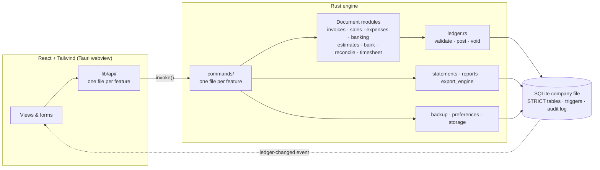

# LocalBooks

**Local-first, double-entry accounting for small businesses.** A classic-style desktop accounting app whose
books live in a single SQLite file on your own machine: no account, no cloud, no telemetry.

Built with **Rust + SQLite (SQLx)** for the accounting engine and **Tauri v2 + React + Tailwind CSS**
for a high-density, keyboard-friendly interface.

---

> **Trying LocalBooks?** Download it and follow the install steps on the
> [**tester page**](https://turbogizzmo.github.io/LocalBooks/). Installed copies update themselves.
>
> **Using LocalBooks?** Start with the [**user guide**](docs/guide/README.md): step-by-step guides
> for invoices, payments, bills, banking, reconciling, reports, closing the books, backups, users and
> passwords, and more. The same guides are built into the app's Help (press F1). What changed in each
> release is in the [changelog](CHANGELOG.md).

## Contents

- [Why LocalBooks](#why-localbooks)
- [Technical highlights](#technical-highlights)
- [Architecture](#architecture)
- [Feature blueprint](#feature-blueprint)
- [Posting rules](#posting-rules)
- [Getting started](#getting-started)
- [Building for release](#building-for-release)
- [Releases and automatic updates](#releases-and-automatic-updates)
- [Where your data lives](#where-your-data-lives)
- [Project layout](#project-layout)
- [Testing](#testing)
- [Known limitations](#known-limitations)
- [License](#license)

---

## Why LocalBooks

- **Your books are a file you own.** Back it up, copy it, archive it; nothing leaves your computer
  unless you send it (an emailed invoice, a bank sync you turn on).
- **The ledger cannot be corrupted by the UI.** Double-entry rules are enforced in Rust *and*
  again by database triggers, so even a bug in a screen cannot persist an unbalanced entry.
- **Familiar workflow.** Invoices, receive payment, bills, pay bills, expenses, checks, deposits,
  transfers, bank feeds, reconciliation, and financial statements in a compact, classic accounting layout.

---

## Technical highlights

### Float-free money (`i64` cents)

Every monetary value is stored and computed as an `i64` count of cents (`$10.50` → `1050`), in
Rust, in SQLite, and in the React UI:

- All tables are `STRICT`, so a `REAL` can never be written into a `*_cents` column.
- Text such as `"1,234.56"`, `"(45.00)"`, or `"$0.29"` is parsed to cents with **string arithmetic**,
  never `parseFloat`; `0.29` is exactly `29` cents.
- Sums use checked arithmetic (`checked_add`, `checked_mul`) with a per-line ceiling, so overflow
  is an error, not a wrap-around.
- **Fractional quantities** (e.g. 1.5 hours) are integers scaled by 10,000. A line amount is
  `round_half_up(quantity_e4 × rate_cents / 10,000)`, computed in 128-bit integers and enforced by a
  `CHECK` constraint. The UI uses the same rule with `BigInt`, so on-screen totals match what posts.

### Multi-currency with realized gains and losses

Invoices and expenses/checks can be issued in a foreign currency at an exchange rate (home units per
foreign unit, stored as an integer scaled by 1,000,000).

- **Journal lines always hold home-currency amounts**, so the trial balance, P&L, and Balance Sheet
  stay in one currency. The original foreign amounts and rate are kept alongside for display.
- Each line converts on its own. Any rounding difference (a cent or two) goes to the largest line on
  the short side, so the converted entry balances exactly.
- **Payments convert at the payment-date rate.** A/R is relieved at the invoice's booked rate,
  cumulatively, so the final payment clears it to the cent. The difference posts to the system
  account **Exchange Gain or Loss**.
- The home currency is a preference and locks once foreign transactions exist.
- **Optional daily exchange rates (uses the network).** With *Look up daily exchange rates* on
  (Settings › Preferences Console, off by default), rate fields are pre-filled with the European
  Central Bank's reference rate for the transaction date, through the open-source
  [Frankfurter](https://github.com/lineofflight/frankfurter) API at `api.frankfurter.dev`. Each
  lookup sends only the two currency codes and a date. Answers are cached in the company file
  (`exchange_rate_cache`), so a date is fetched once and works offline. Weekends and holidays use
  the previous business day's rate. The suggestion can always be overridden, and saved
  transactions keep the rate they were saved with.

### Double-entry enforced at two layers

- **Rust** validates every entry before it is written: at least two lines, each line exactly one of
  debit or credit, and `Σ debits = Σ credits`.
- **SQLite triggers** re-check the balance when an entry flips from `DRAFT` to `POSTED`, and make
  posted entries, their lines, and their source documents **immutable**.
- Each business document (invoice, bill, payment, deposit…) and its journal entry are written in
  **one transaction**. If any step fails, the whole thing rolls back.

### Voiding by reversal, never deletion

`void_transaction` never deletes data. It posts an exact **reversing entry** (debits and credits
swapped, same date), flags the original `is_voided`, and unwinds the source document:

- Voiding a payment reopens its invoice or bill as *Partial* or *Unpaid*.
- Voiding a bank-feed transaction returns the bank line to **For review**.
- A void is refused when a line is reconciled (or ticked in a reconciliation in progress), when an
  invoice or bill still has payments, or when a payment has already been banked in a deposit.

### Trigger-maintained audit log

The `audit_log` table is written **by database triggers**, not by application code: every post,
void, and reconciliation lock is recorded automatically, and `UPDATE`/`DELETE` on the log are
rejected. No code path can skip it.

### Forensic ledger snapshots and integrity verification

`ledger_audit_log` is a second, append-only trail that holds the actual data, not just events:

| Event | Recorded by | Payload |
|---|---|---|
| `POST` | trigger, when an entry is posted | Full JSON snapshot: header, currency, and every line (account, debit, credit, memo) |
| `VOID` | trigger, when an entry is voided | The original entry and the reversing entry that corrected it |
| `MIGRATION` | `db::migrate`, once per schema migration | Version, description, checksum, install time |
| `ACCOUNT_CHANGE` | trigger, on rename, renumber, retype, move, or (de)activation | Before and after values |
| `FORENSIC_HEAL` | a reviewed correction, when approved | The altered entry, the correcting entry, and its lines |
| `LIST_CHANGE` | trigger, on an edit to a customer, vendor or product/service | Name and active flag before and after, and which other fields changed (names only) |
| `CLEANUP` | Accounting › Clean Up Books, once per fix | Every credit applied, invoice written off or payment matched, with amounts |
| `CONDENSE` | Condense Data, once per condense | The archive it was made from (audit-trail head, content hash), the entries summarized, and which summary entry replaced each month |

Posted history can't be edited or deleted. A correction is always a new reversing entry, linked to
the original by its `VOID` record. Changing an account's type once it has posted activity is also
refused, because that would silently move its history between the Balance Sheet and the P&L.

**Audit Log › Verify ledger integrity** rebuilds every posted entry from the live tables and compares
it with the snapshot taken when it was posted. It reports entries that changed after posting, that
don't balance, that were deleted, that lack a snapshot, or that were voided without a recorded
reversal. This catches tampering even by someone who edits the file with an outside tool after
removing the protecting triggers.

**Review corrections…** proposes a fix for each finding, and nothing posts until you approve it:

- **Correctable:** amounts were moved between accounts, or a whole balanced entry was deleted. A new
  balanced entry restores every account to the amount recorded at posting. It is checked again
  against what you reviewed, posts through the normal ledger rules (including the closing date),
  and is logged as `FORENSIC_HEAL`. The altered rows stay in place as evidence.
- **Restore a backup:** the change left debits and credits unequal. No balanced entry can repair
  that, so the fix is a backup taken before the change. Nothing is ever plugged to a suspense
  account to make the totals look right.
- **Review entry:** only a detail such as the date or memo changed, so the account totals are
  unaffected.

The snapshots live in the same file as the ledger and could be altered too. That's why
corrections are reviewed rather than automatic.

### Closing date

*Settings › Preferences Console › Closing date* locks the books through a date. Entries dated on or
before it cannot be posted, from any screen. Voids are blocked too, because a reversal carries the
original date. The ledger checks this before every post, and a database trigger enforces it as a
backstop. Moving or removing the date requires the passcode, which is stored as a salted
PBKDF2-HMAC-SHA256 hash. Every change is appended to `closing_locks`, whose rows can't be edited or
deleted.

### Online snapshots with `VACUUM INTO`

Backups use SQLite's `VACUUM INTO`: a consistent snapshot taken while you keep working, written to a
temp file, integrity-checked, then atomically renamed into place. Restores are verified before
anything is replaced:

| Check | Rejects |
|---|---|
| SQLite header & `integrity_check` | non-SQLite or damaged files |
| `_sqlx_migrations` versions & checksums | files from a newer LocalBooks build, or edited schemas |
| `foreign_key_check` | broken links between records |
| Per-entry `Σ debits = Σ credits` | unbalanced books |

The current books are snapshotted first (`pre-restore-…`), and the backup is upgraded to the current
schema off to the side before it is swapped in. Daily automatic backups run on launch.

### Bank reconciliation that locks history

Statement reconciliation ticks lines until **Difference = $0.00**, then locks them. Reconciled lines
are frozen and their entries can no longer be voided, so a reconciled balance can never drift.

### Desktop Migration Wizard: .qbw import through a staging sandbox

**Settings › Import & Migration** (the Desktop Migration Wizard; also **File › Utilities › Import / Convert…**) reads a desktop accounting company file (`.qbw`) directly using the
open-source [OpenQBW](https://github.com/Sigilweaver/OpenQBW) parser. The file is opened read-only.

1. **Extract.** Invoice line items (source invoice ID, date, signed cents, source table) go into
   `staging_raw_transactions`. These staging tables have no ties to the ledger.
2. **Map.** Each source table found in the file is mapped to a LocalBooks income account.
   **Auto-Generate Missing Accounts** creates any accounts that are missing, numbered 4500 and up.
3. **Post.** Each source invoice becomes one balanced journal entry: credits to the mapped income
   accounts, with the balancing debit to an offset account you choose (default: Opening Balance
   Equity). Every entry goes through the same `post_entry_in_tx` checks as everything else. The
   whole batch posts in one transaction, so it lands completely or not at all. A register keyed by
   source invoice ID stops the same invoice being posted twice. Voiding an imported entry
   releases its invoice so it can be posted again.

The wizard also reads the full ledger (accounts, customers, vendors and every transaction) from
newer company files, **QuickBooks for Mac 2012 and earlier** company files (`.qb2012`, read
directly by `qbmac_import.rs`), QuickBooks `.iif` and Quicken `.qif` exports, and **GnuCash books**
(`.gnucash`, either compressed XML or SQLite). A full import recreates invoices, bills, payments
and the rest as LocalBooks documents. See [the migration guide](docs/guide/desktop-migration.md).

Without a readable company file, the wizard also takes **QuickBooks report exports** (`.csv` or
`.xlsx`) from QuickBooks Desktop for Windows or Mac, or QuickBooks Online: the Journal or General
Ledger, with the Account Listing, contact lists and Item List chosen together. `report_import.rs`
finds each report by its column headings, skips title, total and footer rows, and hands the
transactions to the same resolver as the IIF reader. An expired QuickBooks Desktop for Mac can
still run these reports in view-only mode. See
[docs/guide/desktop-migration.md](docs/guide/desktop-migration.md#import-quickbooks-reports).

**Export from an installed QuickBooks (Preview).** When QuickBooks Desktop still runs on the same
computer, the wizard can ask it for the data through Intuit's public interfaces instead
(`installed_qb.rs`): AppleScript's `executeqbxml` and `reportAsText` on a Mac, the QuickBooks
SDK's `QBXMLRP2.RequestProcessor` over COM on Windows. Only read-only qbXML queries are ever sent;
an allowlist refuses anything else before it leaves LocalBooks. The answers become the same tables
as a report export and go through `report_import.rs`. Neither platform has been tried against a
live QuickBooks yet. See
[docs/guide/desktop-migration.md](docs/guide/desktop-migration.md#quickbooks-still-installed-let-localbooks-export-it).

---

## Architecture



Every successful write emits a `ledger-changed` event, so open screens refresh live.

---

## Feature blueprint

### Features

One row per feature, in alphabetical order, each on its own line, so features added in parallel
land on different lines. Keep a row to one short line and put the details in the feature's guide
under [`docs/guide/`](docs/guide/README.md).

| Feature | Where | What you can do | Guide |
|---|---|---|---|
| Accountant & Taxes reports | Reports | Adjusting Journal Entries, previous reconciliation detail and summary, reconciliation discrepancy, income tax summary and detail by tax line, collections, open purchase orders | [guide](docs/guide/reports.md#accountant--taxes-reports) |
| ACH bill payments | Expenses › Bills | Pay bills with a NACHA ACH file for your bank to upload | [guide](docs/guide/bills.md) |
| AI access (MCP) | Settings › AI Access (MCP) | Local, read-only access to your books for an AI assistant | [guide](docs/guide/ai-assistant.md) |
| Audit log | Accounting › Audit Log | Read-only trail of every posting, void and account change, with integrity checks | [guide](docs/guide/ledger-integrity.md) |
| Backups & company files | Settings › File & Data Controls | Backups and restore, open or create a company file, move its location | [guide](docs/guide/backups-and-company-files.md) |
| Bank feeds | Banking › Bank Feeds | CSV/OFX and PDF statement import (with a balance check) and SimpleFIN bank connections, with rule learning | [guide](docs/guide/bank-feeds.md) |
| Bills & Pay Bills | Expenses › Bills | Split-line bills with total validation; pay several at once | [guide](docs/guide/bills.md) |
| Budgets & comparisons | Reports | Budget vs. Actual and previous-year comparisons for the P&L and Balance Sheet | [guide](docs/guide/reports.md) |
| Change Item Prices | Sales › Products & Services | Bulk price changes by percentage or amount, recorded in the audit trail | [guide](docs/guide/customers-and-products.md) |
| Clean Up Books | Accounting › Clean Up Books | Client Data Review tools: apply unapplied credits, clear Undeposited Funds, write off invoices, review list changes, compare inventory | [guide](docs/guide/cleaning-up-books.md) |
| Condense Data | Settings › File & Data Controls | Replace closed years with monthly summary entries, keeping open items, with a verified read-only archive of the full history | [guide](docs/guide/backups-and-company-files.md#condense-data-archive-closed-years) |
| Credit card credits | Expenses › Expenses & Checks | Vendor refunds onto a card | [guide](docs/guide/expenses-and-checks.md) |
| Currency revaluation | Accounting › Currency Revaluation | Unrealized exchange gains and losses on foreign balances; optional daily ECB rates | [guide](docs/guide/currency-revaluation.md) |
| Custom fields | Sales › Reps, Ship Via & Fields | Up to 15 custom fields per customer, vendor and item list, printable on sales forms | [guide](docs/guide/customers-and-products.md) |
| Custom forms & email | Settings › Custom Forms · Email; Sales › Send Forms | Invoice and estimate designer, PDFs, mail app or SMTP, sent history, Email later queue | [guide](docs/guide/custom-forms.md) |
| Custom reports | Reports | Detail reports (P&L and Balance Sheet Detail, aging details, Open Invoices, customer and vendor balances, sales, purchases and income by name or item, Check and Deposit Detail, 1099 Detail, Journal, Transaction List) you can filter, regroup and save as memorized reports | [guide](docs/guide/reports.md#customize-a-report) |
| Customer statements | Sales › Customer Statements | Statements with running balance and aging, printed or emailed | [guide](docs/guide/custom-forms.md) |
| Customers, products & vendors | Sales › Customers · Products & Services; Expenses › Vendors | Lists with balances; products fill in invoice lines | [guide](docs/guide/customers-and-products.md) |
| Dashboard | Dashboard | Assets vs. liabilities (12 months), live trial balance, A/R aging | [guide](docs/guide/getting-started.md) |
| Deposits & transfers | Banking › Deposits & Transfers | Bank deposits from Undeposited Funds, transfers between accounts | [guide](docs/guide/deposits-and-transfers.md) |
| Desktop Migration Wizard | Settings › Import & Migration; File › Utilities › Import / Convert… | `.qbw`, QuickBooks for Mac 2012, IIF, QIF, QuickBooks report and GnuCash import through a staging sandbox | [guide](docs/guide/desktop-migration.md) |
| Export from installed QuickBooks (Preview) | Settings › Import & Migration › step 1 | Asks a running QuickBooks Desktop (Mac or Windows) for its lists and Journal, read-only | [guide](docs/guide/desktop-migration.md#quickbooks-still-installed-let-localbooks-export-it) |
| Estimates | Sales › Estimates | Non-posting quotes, converted to an invoice in one step | [guide](docs/guide/sales-receipts-and-estimates.md) |
| Expenses & checks | Expenses › Expenses & Checks | Split expenses and checks with auto-numbering | [guide](docs/guide/expenses-and-checks.md) |
| Finance charges | Sales › Assess Finance Charges | Interest on overdue invoices (rate, minimum, grace days), in integer cents | [guide](docs/guide/customer-payments.md) |
| Find Transactions | Accounting › Find Transactions; Edit › Find… | Search by text, dates, number, amount, type, name and account | [guide](docs/guide/journal-entries-and-voids.md#find-a-transaction) |
| Graphs | Reports › Graphs | Income and expense, net worth, receivables, payables, sales and budget vs. actual charts that open the report behind each bar; table view, PNG, print, Excel and CSV | [guide](docs/guide/reports.md#graphs) |
| Inventory | Sales › Products & Services | Tracked stock at moving-average cost, adjustments, valuation and stock status | [guide](docs/guide/inventory.md) |
| Invoices & payments | Sales › Invoices · All Sales | Inline line-item grid, full and partial payments | [guide](docs/guide/invoices.md) |
| Job costing | Reports › Jobs; Customer:Job on bill, expense and vendor credit lines | Job and item profitability, estimates vs. actuals, Profit and Loss by Job, estimates by job, progress invoicing | [guide](docs/guide/reports.md#job-costing-reports) |
| Menu bar | Menu bar | Classic desktop menus (Lists, Company, Customers, Vendors, Employees, Banking, Reports) that open each form and report, with Ctrl+I, Ctrl+W, Ctrl+R, Ctrl+J, Ctrl+T and Ctrl+F | [guide](docs/guide/getting-started.md#find-things-in-the-menu-bar) |
| Journal entries | Accounting › Journal Entries | Balanced manual entries; register with void/reversal pairs | [guide](docs/guide/journal-entries-and-voids.md) |
| New Company setup | File › New Company… | QuickBooks-style setup: 33 industries with suggested charts of accounts, equity by tax form, sales tax and inventory | [guide](docs/guide/getting-started.md#create-a-new-company) |
| Price levels | Sales › Products & Services · Customers; Reports | Fixed % and per-item price levels, a default level per customer that fills in sales form rates, the Item Price List, imported from IIF and QuickBooks files | [guide](docs/guide/customers-and-products.md#price-levels) |
| Preferences | Settings › Preferences Console | Company details, logo, fiscal year, currency symbol, tax calendar | [guide](docs/guide/getting-started.md) |
| Reconcile | Banking › Reconcile | Statement reconciliation that locks matched history | [guide](docs/guide/reconciling.md) |
| Reminders & To Do list | Dashboard; Accounting › To Do List; + New › To Do | What needs attention today (overdue invoices, bills due, to-dos, recurring, Email later, tax dates, backup), and tasks with due dates and assignees | [guide](docs/guide/reminders-and-todos.md) |
| Reports | Reports | P&L, Balance Sheet, cash flows, aging, summaries, Missing Checks, trial balance, general ledger; accrual or cash; Excel, CSV and PDF | [guide](docs/guide/reports.md) |
| Sales receipts | Sales › All Sales | Sales paid at the time of sale | [guide](docs/guide/sales-receipts-and-estimates.md) |
| Sales reps & Ship Via | Sales › Reps, Ship Via & Fields | Optional sales reps, shipping methods and ship dates on sales forms | [guide](docs/guide/customers-and-products.md) |
| Sortable lists | Any list | Click a column heading to sort by it; click again to reverse | [guide](docs/guide/getting-started.md#sort-a-list) |
| Time tracking | Employees › Time Tracking | Single activities and weekly timesheets (billable hours, rates) | [guide](docs/guide/time-tracking.md) |
| Users & passwords | Settings › Users & Passwords | Optional users with roles, sign-in, recovery key, encrypted vendor tax IDs | [guide](docs/guide/users-and-passwords.md) |

### `+ New` quick-create matrix

Open with the **+ New** button or <kbd>Ctrl/Cmd</kbd>+<kbd>Alt</kbd>+<kbd>N</kbd>. Each item opens
its entry form with focus in the first field.

| Customers | Vendors | Employees | Other |
|---|---|---|---|
| Invoice | Expense | Single Time Activity | Journal Entry |
| Receive Payment | Check | Weekly Timesheet | Bank Deposit |
| Estimate | Bill | | Transfer |
| Sales Receipt | Pay Bills | | To Do |
| | Credit Card Credit | | |

---

## Posting rules

| Transaction | Debit | Credit |
|---|---|---|
| Invoice | Accounts Receivable | Income (per line's account) |
| Finance charge (an invoice per customer, from Assess Finance Charges) | Accounts Receivable | The finance charge income account |
| Receive payment | Bank or Undeposited Funds | Accounts Receivable |
| Sales receipt | Bank or Undeposited Funds | Income |
| Bill | Expense / asset (one debit per distinct split account) | Accounts Payable |
| Payment on a foreign invoice | Bank (at payment rate) + Exchange **loss** | A/R (at booked rate) + Exchange **gain** |
| Pay bill | Accounts Payable | Bank or Credit Card |
| Expense / Check | Expense / asset (per split) | Bank (or Credit Card for expenses) |
| Credit card credit | Credit Card | Expense / asset (per split) |
| Bank deposit | Bank | Undeposited Funds (selected payments) + other lines |
| Transfer | To-account | From-account |
| Bank feed approval | Becomes a real Expense (money out) or Deposit (money in) | |
| Imported (.qbw) invoice | Offset account (e.g. Opening Balance Equity) | Mapped income account(s) |
| Sale of a tracked product (added to the invoice or sales receipt entry) | Cost of Goods Sold, at moving average cost | Inventory Asset |
| Bill line for a tracked product | Inventory Asset (quantity and value added) | Accounts Payable |
| Inventory adjustment | Inventory Asset (added) or the chosen expense (removed) | The chosen account (added) or Inventory Asset (removed) |
| Currency revaluation (reversed the next day) | A/R (gain) or Unrealized Exchange Gain or Loss (loss) | The other |
| Write-off (Clean Up Books: a credit memo applied to the invoice) | The chosen bad debt (expense) or discount (income) account | Accounts Receivable |
| Undeposited Funds match (Clean Up Books) | The account the deposit line used (usually income) | Undeposited Funds |
| Void | Exact reversal of the original entry, same date | |
| Estimate / time activity | *Non-posting* (an estimate becomes an invoice only when that invoice posts) | |

Statements: **Balance Sheet** closes prior fiscal years' profit into Retained Earnings and shows the
current fiscal year as Net Income. The fiscal year start month is a preference.

---

## Getting started

### Prerequisites

| Tool | Version |
|---|---|
| [Rust](https://rustup.rs) | stable (developed on 1.98) |
| [Node.js](https://nodejs.org) | 20 LTS or newer |
| Platform dependencies | See the [Tauri v2 prerequisites](https://v2.tauri.app/start/prerequisites/) |

Platform notes:

- **macOS:** Xcode Command Line Tools (`xcode-select --install`).
- **Windows:** Microsoft C++ Build Tools and WebView2 (preinstalled on Windows 10/11).
- **Linux:** `webkit2gtk-4.1`, `libssl`, `librsvg` and build essentials (package names per distro in the Tauri guide).

### Run in development

```bash
npm install
npm run tauri dev
```

This starts the Vite dev server on port 1420 and launches the desktop window with hot reload. The
company file is created and migrated automatically on first launch.

---

## Building for release

```bash
npm run build:mac        # macOS: signed updater bundle; key from ~/.tauri, password from Keychain
```

On other platforms set `TAURI_SIGNING_PRIVATE_KEY` (the key, or a path to it) and
`TAURI_SIGNING_PRIVATE_KEY_PASSWORD`, then run `npm run tauri build`. Bundles include updater
artifacts (`createUpdaterArtifacts`), so a build without the update key fails.

This builds the frontend, compiles Rust in release mode (with LTO), embeds the UI in the binary, and
produces platform bundles under `src-tauri/target/release/bundle/`:

| Platform | Output |
|---|---|
| macOS | `macos/LocalBooks.app`, `dmg/LocalBooks_<version>_<arch>.dmg` |
| Windows | `msi/*.msi`, `nsis/*-setup.exe` |
| Linux | `deb/*.deb`, `appimage/*.AppImage`, `rpm/*.rpm` |

Caveats:

- **Build on the target OS.** Tauri bundles are produced natively; cross-compiling installers (for
  example a Windows `.msi` from macOS) is not supported in practice. Use CI runners per platform.
- `cargo build --release` alone does **not** embed the frontend; use `npm run tauri build`.
- **Code signing:** macOS builds are ad-hoc signed (`signingIdentity: "-"`) but not notarized, so
  Gatekeeper asks testers to choose *Open Anyway* once; Windows SmartScreen asks them to choose
  *Run anyway*. Notarizing with an Apple Developer ID and signing Windows installers removes those
  prompts.
- **Headless macOS builds:** the DMG step scripts Finder to lay out the window. In CI or over SSH,
  build with `CI=true npm run tauri build` to skip that styling.
- Apple Silicon and Intel produce separate binaries; add `--target universal-apple-darwin` for a
  universal build (requires both Rust targets).

---

## Releases and automatic updates

Installed copies check `releases/latest/download/latest.json` a few seconds after launch (and from
**Settings › Updates**), show the release notes, and install with one click. A download is installed
only if its [minisign](https://jedisct1.github.io/minisign/) signature matches the public key in
`tauri.conf.json`; the private key never leaves the maintainer's machine and the
`TAURI_SIGNING_PRIVATE_KEY` / `TAURI_SIGNING_PRIVATE_KEY_PASSWORD` repository secrets. Before a new
version upgrades a company file's schema, it saves a verified copy to the local backups folder
(*Before upgrade*, newest five kept).

To ship a release:

1. In one release PR:
   - bump `version` in `src-tauri/tauri.conf.json`, `src-tauri/Cargo.toml` and `package.json` (and
     the lockfiles);
   - add a `## [<version>]` section to `CHANGELOG.md`, written for the people using LocalBooks. It
     becomes the release notes on GitHub and in the app's update window;
   - update the tester page (`site/index.html`): **What's new to test in <major.minor>**, the sample
     update bar, and any install, update or **Move your books** steps the release changes;
   - check that every feature in the release has its guide section, Help topic and README row (see
     [docs/dev/parallel-work.md](docs/dev/parallel-work.md)).

   `docs_checks` fails the PR if the changelog section or the tester page's What's new is missing
   for the new version, or if a guide isn't linked from the page, Help and the guide index.
2. `git tag v0.2.0 && git push origin v0.2.0`. CI tests on all three platforms, builds signed
   installers and `latest.json`, and attaches them to a **draft** release.
3. Edit the draft's notes (they appear in the app's update prompt) and publish it as a
   **pre-release** (a preview on the tester page). Installed copies don't see it yet: the
   updater follows the latest release.
4. Publishing starts the **Release check** (`release-check.yml`, also runnable by hand with the tag).
   On macOS, Windows and Linux it verifies the signed installers and `latest.json`, upgrades test
   companies seeded by the previous release, and launches the installed app. See
   [docs/testing/release-check.md](docs/testing/release-check.md).
5. Once the release check is green on all three platforms, promote the release to **latest**.
   Installed copies then offer the update.

Windows updates use the per-user `-setup.exe` installer, the one the tester page recommends.

### CI and repository automation

| Workflow | When | What |
|---|---|---|
| `release.yml` | push, pull request, tag, manual | Tests on macOS, Windows, Linux; installers on tags and manual runs |
| `release-check.yml` | pre-release or draft published/edited, manual | The gate before latest: signatures and `latest.json`, upgrade from the previous release, launch smoke, on all three platforms |
| `codeql.yml` | push, pull request, weekly | Static security analysis of Rust, JavaScript and the workflows |
| `audit.yml` | lockfile changes, weekly | RustSec and npm advisories for shipped dependencies |
| `notices.yml` | lockfile changes, weekly | Fails when `THIRD-PARTY-NOTICES.txt` no longer matches the shipped dependencies |
| `pages.yml` | changes to `site/` | Publishes the [tester page](https://turbogizzmo.github.io/LocalBooks/) |
| Dependabot | weekly | Grouped update PRs for Cargo, npm and GitHub Actions |

Security reports: see [SECURITY.md](SECURITY.md).

---

## Where your data lives

| Platform | Company file (default) |
|---|---|
| macOS | `~/Library/Application Support/com.localbooks.desktop/localbooks.db` |
| Windows | `%APPDATA%\com.localbooks.desktop\localbooks.db` |
| Linux | `~/.local/share/com.localbooks.desktop/localbooks.db` |

- **Automatic and pre-restore backups** go to a `backups/` folder beside the default company file.
  They stay on the local disk even when the company file lives elsewhere.
- **Custom location:** *Settings › File & Data Controls › Change Company File Location…* points
  LocalBooks at another folder (recorded in `config.json` in the app config directory).
- **Network drives and synced folders** (SMB/NFS, Dropbox, iCloud Drive, OneDrive, Google Drive)
  are supported for **one user at a time**. On Windows, mapped drive letters (`Z:\Accounting`) are
  resolved to their UNC share (`\\server\share\Accounting`) with `WNetGetConnectionW`.
  LocalBooks switches SQLite to rollback-journal mode with
  exclusive locking there and keeps a heartbeat lock file, so a second computer is told the books
  are in use instead of corrupting them. Never open the same company file on two computers at once.
- **`.localbooks` files:** backups are saved as `.localbooks` files, and installed builds register
  that extension. Double-clicking one, or choosing *Settings › File & Data Controls › Open Company
  File…*, checks it the same way a restore does and then opens it **in place** for the session.
  The window title and toolbar show which file is open, and your usual company file location is
  unchanged. Windows and Linux pass the file as a launch argument; macOS hands it to the running
  app.
- **One LocalBooks at a time.** If a second launch finds LocalBooks already running, it hands over
  its `.localbooks` file (or just a request to come forward) and exits. The running app opens the
  file and brings its window forward. The handoff uses its own channel: a random loopback port and
  a per-user secret in `instance.json`, readable by the owner only. It is separate from the
  read-only MCP server.

## Local AI access (MCP)

*Settings › AI Access (MCP)* starts a small [Model Context Protocol](https://modelcontextprotocol.io)
server at `http://127.0.0.1:8321/mcp`. Through it, an AI assistant on the same computer (Claude
Code, Claude Desktop, or any MCP client with Streamable HTTP) can call three **read-only** tools:

| Tool | Returns |
|---|---|
| `get_trial_balance` | Debit/credit balance of every account as of a date |
| `get_profit_and_loss_summary` | Revenue, gross profit, expenses, net income, and per-account amounts for a range (default: fiscal year to date) |
| `get_overdue_aging_metrics` | Receivables by days past due, overdue share, and the most overdue invoices |

- **Off by default.** It uses tokio's own networking (no web framework) and opens no outbound
  connections.
- **Loopback only.** It binds to `127.0.0.1` and drops non-loopback peers.
- **Token required.** Every request needs a 256-bit bearer token generated on this machine. The
  token is stored in `mcp.json` in the app config folder, not in the company file.
- **Browsers refused.** It rejects requests that carry an `Origin` header (web pages) or a foreign
  `Host` header (DNS rebinding), as the MCP specification requires.
- **No write path.** The tools run SELECT queries only; nothing can post, void, or edit.

LocalBooks itself sends nothing anywhere, but the assistant you connect may send what it reads to
its AI provider. Connect with:

```bash
claude mcp add --transport http localbooks http://127.0.0.1:8321/mcp --header "Authorization: Bearer <token from Settings>"
```

---

## Project layout

```
.
├── index.html                  # #root (app) and #print-root (printable documents)
├── src/                        # React frontend
│   ├── App.jsx                 # routing, + New intents, company context
│   ├── components/             # one file per screen plus shared grids, menus and print documents
│   ├── lib/                    # api.js + api/ (Tauri bindings, one file per feature), money.js, dates.js
│   └── styles/print.css        # US Letter print designer
├── tailwind.config.js          # color tokens and dense components
└── src-tauri/
    ├── migrations/             # 0001–0010 SQL migrations (schema, triggers, seed data)
    ├── capabilities/           # Tauri permission set
    ├── tauri.conf.json
    └── src/
        ├── main.rs             # app setup, clean shutdown
        ├── commands/           # Tauri command layer, one file per feature (see docs/dev/parallel-work.md)
        ├── db.rs               # connection handling, migrations, hot-swap & relocation
        ├── ledger.rs           # validation, posting, voiding, journal register, audit queries
        ├── invoices.rs, finance_charges.rs, sales.rs, item_prices.rs, estimates.rs, expenses.rs, banking.rs, bank.rs,
        ├── reconcile.rs, timesheet.rs       # business documents
        ├── sales_lists.rs, custom_fields.rs # sales reps, Ship Via, custom fields
        ├── simplefin.rs        # SimpleFIN bank connections (claim, link, sync)
        ├── fx_rates.rs         # opt-in ECB exchange-rate lookup (Frankfurter) and its cache
        ├── bank_pdf.rs         # PDF bank and card statements: text layout to transaction table
        ├── forms.rs, pdf.rs    # form designer layouts and the PDF writer
        ├── mail_app.rs, smtp.rs, secrets.rs   # emailing forms; credentials on this computer
        ├── email_log.rs        # sent history (append-only) and the Email later queue
        ├── statements.rs, reports.rs, export_engine.rs   # P&L, Balance Sheet, dashboard, CSV
        ├── custom_reports.rs   # custom report engine: detail-report presets, memorized reports
        ├── xlsx_export.rs      # Excel workbooks with typed cells (rust_xlsxwriter)
        └── backup.rs, preferences.rs, storage.rs         # backups, settings, tax calendar, storage
```

---

## Testing

```bash
cd src-tauri
cargo test
```

The suite (107 tests, plus 4 opt-in diagnostics) runs against real SQLite databases with every migration applied, on macOS,
Windows, and Linux in CI. It covers
balanced and unbalanced posting, rollback on failure, partial payments and aging, reconciliation
locking, voiding and document unwinding, split bills, deposits, transfers, estimates, time limits,
statement tie-outs across fiscal years, CSV round-trips, backup/restore rejection cases,
relocation, lock files, fractional-quantity rounding, foreign-currency conversion, and realized
exchange gains and losses, and the .qbw import (mapping rules, duplicate prevention,
re-posting after a void, and rollback when a batch fails partway through), the forensic audit
trail (tamper detection with the triggers removed), opening `.localbooks` files, closing-date locks (including the RFC 7914 PBKDF2 test vector),
the single-instance handoff, reviewed forensic corrections, and the MCP server
(protocol lifecycle, tool output, and every transport guard over real sockets), and SimpleFIN bank
connections against a mock server (single-use tokens, credentials kept out of the company file and
error messages, sync windows, duplicate-free re-syncs, and reconnecting on another computer).

---

## Known limitations

- **No payroll.** Employees exist for time tracking only; there are no paychecks, withholding, or
  payroll tax filings.
- **Job costing** doesn't cost time: time activities have a billing rate but no cost rate. Estimates
  have no cost column, so estimates vs. actuals compare revenue, and an estimate becomes a single
  invoice (no partial progress invoices).
- **Sales tax** is one rate (and agency) per invoice or receipt; there are no multi-jurisdiction
  returns.
- **Foreign currency** covers invoices (with their payments) and expenses/checks. Bills, sales
  receipts, and estimates are home-currency only, and bank accounts are always home currency. Open
  foreign-currency invoices can be revalued at period end (Accounting › Currency Revaluation).
- **One person at a time.** A company file can have several users, each with a password and a role
  (Settings › Users & Passwords), but only one person can have it open at a time, including on
  shared folders.
- Whether the `.localbooks` file type is registered on Linux depends on the desktop environment.
- **Tax calendar** covers federal due dates for Schedule C, 1065, 1120-S and 1120 only. Weekends roll to
  Monday; holidays, extensions, disaster relief and state deadlines are not applied. Confirm dates
  with the IRS or your tax advisor.
- **The .qbw import is partial.** OpenQBW 0.1 decodes invoice line items only. It does not
  read account names, customers, vendors, bills, checks, payments, or memos. Some amount encodings
  are still undecoded; those lines are counted and shown, not guessed. Compressed backups (`.qbb`)
  and portable files (`.qbm`) must be restored to a `.qbw` in the program that created them first.
  Review imported totals against that program's reports.
- **IIF and QIF imports.** IIF files don't link payments to invoices, so payments apply to the
  oldest open invoices, as QuickBooks does. QIF investment accounts are skipped. A file with lists
  but no transactions adds its accounts, customers, vendors and items and posts nothing.
- **QuickBooks report imports** (Journal or General Ledger exported to CSV or Excel, with the
  Account Listing, contact lists and Item List) read Debit and Credit columns only; a report with
  just an Amount column is refused. Like IIF, they don't link payments to invoices, so payments
  apply to the oldest open invoices. QuickBooks Online's Journal has no transaction number, so its
  lines are grouped by date, type and number until they balance. A General Ledger's lines are
  paired back into transactions through its Split column; lines that can't be paired are listed,
  not posted. Item quantities, classes and sales tax codes on transaction lines are not read.
- **Export from an installed QuickBooks** is a Preview: it has not been tried against a running
  QuickBooks on either platform. On a Mac it needs the Journal report open in front, and older
  QuickBooks for Mac versions may lack the AppleScript commands; on Windows it needs Intuit's free
  QuickBooks SDK. Classes are counted, not imported, and the limits of report imports apply.
- **GnuCash imports.** Stock and mutual fund accounts are skipped. Amounts that aren't whole cents,
  and foreign-currency transactions with no home-currency amount, are listed for manual entry
  rather than rounded or converted. Scheduled transactions, budgets and prices aren't imported.
- **Inventory** uses moving average cost (no FIFO/LIFO). Stock is bought on bills (not on expenses or
  checks) and can't be sold on foreign-currency invoices. Selling below zero is allowed: those units
  are costed at the last purchase cost and trued up to actual cost when the stock is bought.
- Currency amounts use two decimal places (zero-decimal currencies such as JPY display with `.00`).

---

*LocalBooks stores and computes everything locally. Review your financial statements with a
qualified accountant before filing.*

---

## License

LocalBooks is released under the [MIT License](LICENSE).

It includes open-source components under their own licenses, among them
[OpenQBW](https://github.com/Sigilweaver/OpenQBW) and
[OpenSQLAnywhere](https://github.com/Sigilweaver/OpenSQLAnywhere) (Apache-2.0, by Nathan Riley),
which read QuickBooks company files. [THIRD-PARTY-NOTICES.txt](THIRD-PARTY-NOTICES.txt) lists every
shipped Rust crate and npm package with its license, and reproduces their NOTICE files and license
texts. The installers carry it, and the app shows it under Help › About LocalBooks.

After changing dependencies (`Cargo.lock` or `package-lock.json`), run `npm ci` and then
`node scripts/third-party-notices.mjs`, and commit the regenerated file; `notices.yml` fails on pull
requests until it matches. Dependabot pull requests need the same step.

QuickBooks® is a registered trademark of Intuit Inc. LocalBooks is an independent project and is
not affiliated with, endorsed by, or sponsored by Intuit Inc.
